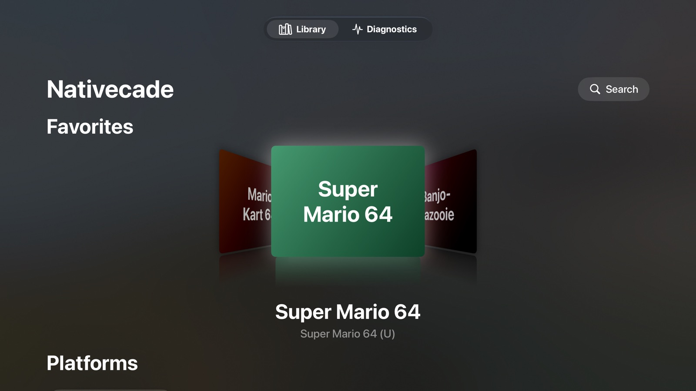
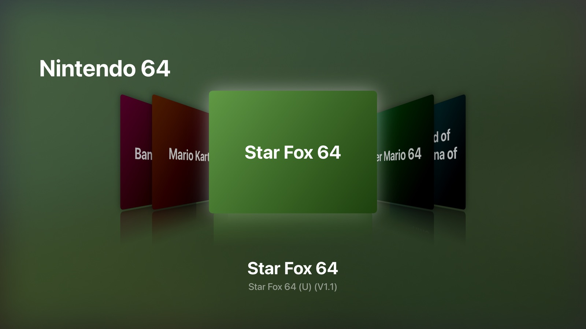
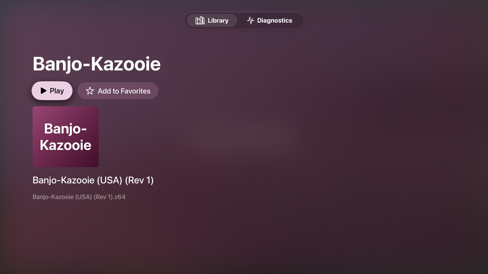
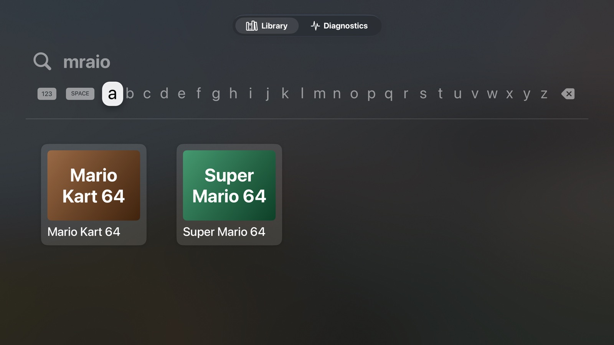
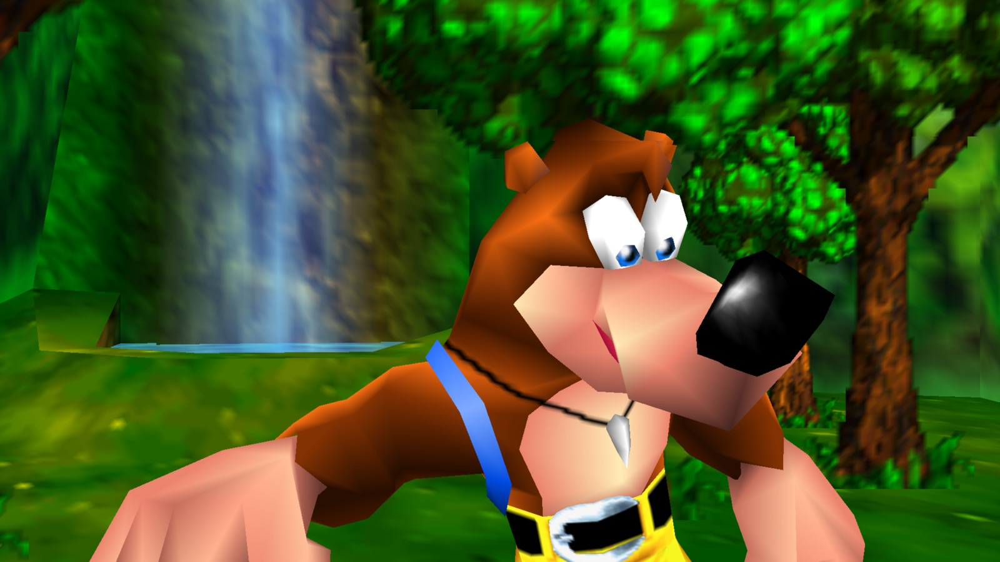
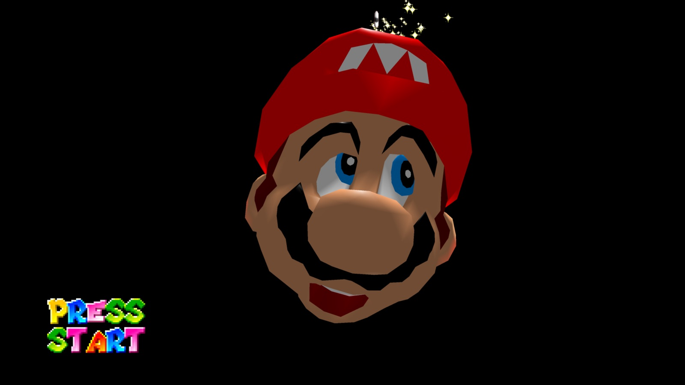
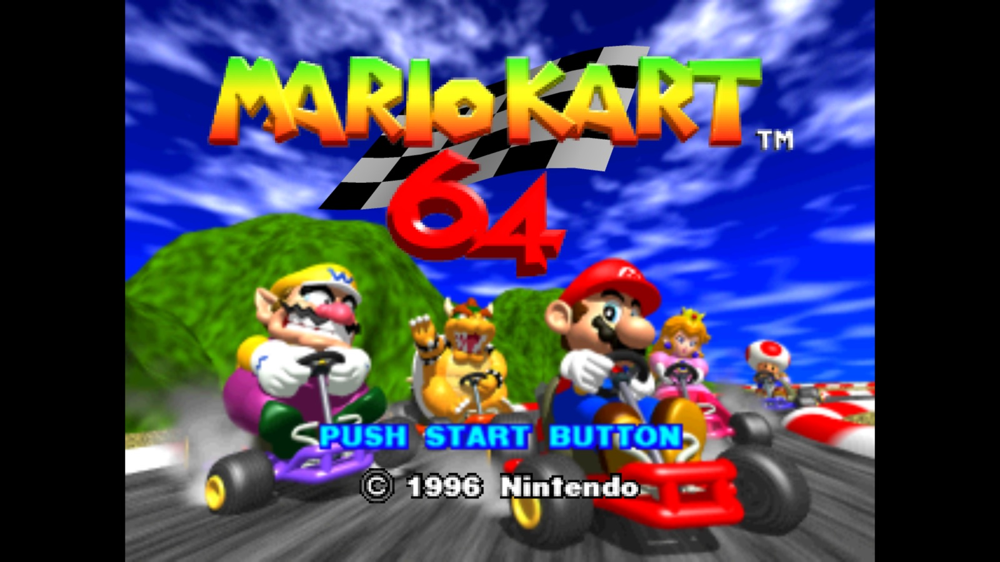
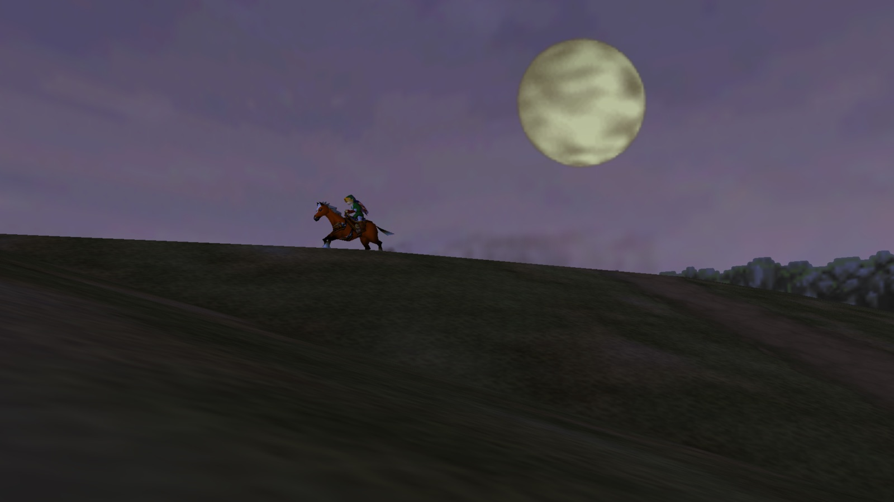
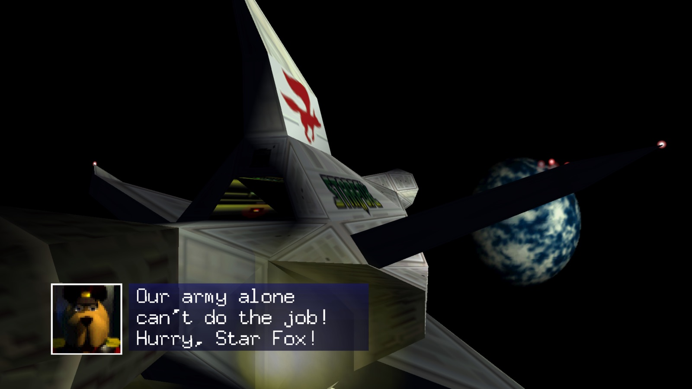

# Nativecade

**Classic games, built for Apple TV.**

Nativecade is the working name for a native Apple TV launcher that discovers a user's game library through SMB or RomM and runs supported native ports and statically recompiled games locally on tvOS. The Xcode project is named RecompTV; the playable app uses the **Nativecade** scheme.

The [branding preview](docs/branding/nativecade/nativecade-brand-preview.png), [logo](docs/branding/nativecade/nativecade-logo-on-light.png), and [Apple TV icon concept](docs/branding/nativecade/nativecade-tv-icon.png) are saved with [design notes](docs/branding/nativecade/brand-notes.txt).

**Status: Nativecade integrates RomM/SMB browsing, verified ROM import, on-device asset preparation, and playable Ocarina of Time and Mario Kart 64 ports, with Star Fox 64, Super Mario 64 and Banjo-Kazooie running in the simulator.** Both Apple TV and simulator runtimes build; Mario Kart's menu navigation and race acceleration have passed a simulator controller test. Physical Apple TV validation remains pending. See [Nativecade build and TestFlight](docs/NATIVECADE_TESTFLIGHT.md), [Mario Kart integration](docs/SPAGHETTIKART.md), and the [Shipwright baseline](docs/SHIPWRIGHT_PORT.md). Earlier Zelda64Recomp/RT64 experiments remain separate from the app.

## Screenshots

From the tvOS 27 Apple TV 4K simulator. Game images belong to their publishers. No game data is included in this repository; each game is prepared on the device from the player's own ROM.

| Home screen with Favorites | A platform's games in cover flow |
| --- | --- |
|  |  |

| A game's page | Search finds games despite typos |
| --- | --- |
|  |  |

| Banjo-Kazooie (Lighthouse) | Super Mario 64 (Ghostship) | Mario Kart 64 (SpaghettiKart) |
| --- | --- | --- |
|  |  |  |

| The Legend of Zelda: Ocarina of Time (Shipwright) | Star Fox 64 (Starship) |
| --- | --- |
|  |  |

## Run the launcher

Prepare the native runtime and support resources using [Nativecade build instructions](docs/NATIVECADE_TESTFLIGHT.md), then open `RecompTV.xcodeproj`, resolve Swift packages, select **Nativecade** and an Apple TV simulator, and Run. The **RecompTV** scheme remains a standalone diagnostics/library harness without gameplay. In **Library**, add an SMB share or RomM connection and import an uncompressed N64 ROM. See [Network sources](docs/NETWORK_SOURCES.md) for connection details and testing. No project-generation tool is required.

The **Diagnostics** tab shows the native C++ result, a solid Metal test surface, and separate GPU-completion and user-confirmed visual evidence. See [Foundation harness](docs/FOUNDATION_HARNESS.md) for setup, checks, limitations, and the physical-device evidence to collect. The provisional tvOS 17 deployment floor is for the harness only.

Portable native checks: `sh scripts/test-native.sh`. Presentation-state checks with Swift 6: `sh scripts/test-evidence.sh`. GitHub CI also builds unsigned simulator and device targets; it does not establish physical-device support.

## Project direction

- Deliver one native tvOS app with a SwiftUI interface and controller navigation.
- Use existing SMB shares, including NAS or Unraid storage, without custom server software.
- Offer RomM as an optional source of library metadata, artwork, and ROM downloads. SMB must work independently.
- Execute games on Apple TV using bundled native ARM64 game code and a renderer targeting Metal.
- Require user-supplied game data and validate the exact ROM revision before launch.
- Fetch and cache individual games as needed instead of copying an entire collection.
- Keep library providers and game runtimes modular so other sources and consoles can be considered later.

A discovered game is not automatically playable. Each supported title needs a compatible game-specific runtime included in the app. Adding a ROM to RomM or an SMB folder does not create that runtime.

## First milestone

The first game is **The Legend of Zelda: Ocarina of Time**, using **Ship of Harkinian (Shipwright)** and a user-supplied ROM. Shipwright compiles decompiled game source and uses libultraship's renderer; it is a different integration from Zelda64Recomp and RT64. The ROM supplies game assets to the native port.

The second integrated game is **Mario Kart 64 (USA)**, using **SpaghettiKart 1.0.0**. Its hidden game symbols and separate save directory allow it to share Nativecade's SDL/Metal services with Shipwright. The agreed order is to expand N64 coverage before adding other platforms. Each added title needs a compatible native runtime and its own validation. A shared launcher does not automatically make every N64 ROM executable.

The third, **Star Fox 64 (USA)** with **Starship v2.0.0**, prepares and runs in the simulator and switches with the other games; controller play and Apple TV testing are still to come. See [Star Fox 64](docs/STARSHIP.md).

The fourth, **Super Mario 64 (USA)** with **Ghostship 3.0.0**, reaches its title screen in the simulator and switches with the other games; controller play and Apple TV testing are still to come. See [Super Mario 64](docs/GHOSTSHIP.md).

The fifth, **Banjo-Kazooie** (all four retail releases) with **Lighthouse 1.2.2**, plays its opening in the simulator and switches with the other games; controller play and Apple TV testing are still to come. Every game now shares the newer libultraship and Torch that Lighthouse ships. See [Banjo-Kazooie](docs/LIGHTHOUSE.md).

A sixth, **Star Wars: Shadows of the Empire** with the **SotE-Recomp** recompilation, is in progress. A recompilation's code is generated from a ROM, which no build that leaves this Mac may contain, so Nativecade runs the game's code from the player's ROM with an [N64 interpreter](docs/N64_INTERPRETER.md) instead. It plays headless in the simulator, where its RT64 renderer can't draw, and needs Apple TV testing. See [Shadows of the Empire](docs/SOTE.md).

The integrated games need device testing; network browsing and verified imports can still be developed and tested independently with the RecompTV harness. Desktop or macOS support is useful starting evidence, but does not establish tvOS compatibility. See [POC.md](POC.md) for the checkpoints and required evidence.

## Intended technology stack

| Area | Direction | Validation still needed |
| --- | --- | --- |
| App and library UI | Swift, SwiftUI, native tvOS | Focus navigation and runtime presentation |
| Game execution | Game-specific C/C++ code compiled ahead of time for ARM64 | tvOS dependency and lifecycle support |
| Graphics | Metal on Apple TV | Selected runtime renderer and device feature requirements |
| Input | Apple Game Controller framework | Mapping, disconnects, pause, and resume |
| Library sources | AMSMB2 4.0.3 and RomM 5.4.1 API contract, cover cards and screenshots with offline caching | Live intended-server artwork and broader version coverage |
| Game data | User-supplied ROMs, validated local cache | Revision hashes, format handling, storage limits |
| Saves | Local runtime saves, preference recovery, optional versioned RomM backups | Physical Apple TV recovery and intended-server validation |

The source/import implementation is described in [Network sources](docs/NETWORK_SOURCES.md); the runtime, controller and save integrations remain work in progress.

## Documentation

| Document | Purpose |
| --- | --- |
| [Product requirements](PRODUCT_REQUIREMENTS.md) | User flows, MVP boundaries, and acceptance criteria |
| [Architecture](ARCHITECTURE.md) | App components, providers, runtime boundary, and data flow |
| [Roadmap](ROADMAP.md) | Milestones ordered around technical feasibility |
| [Proof of concept](POC.md) | First native tvOS experiment and go/no-go evidence |
| [Nativecade and TestFlight](docs/NATIVECADE_TESTFLIGHT.md) | Build the playable app, import a ROM, and archive for Apple TV |
| [Network sources](docs/NETWORK_SOURCES.md) | RomM/SMB setup, verified ROM imports, storage limits, and fixture tests |
| [Foundation harness](docs/FOUNDATION_HARNESS.md) | Open the Xcode project, run checks, and collect device evidence |
| [Simulator progress](docs/SIMULATOR_PROGRESS.md) | Maintainer-confirmed checks and remaining evidence |
| [Nintendo 64 games](docs/N64_GAMES.md) | Each game's state in Nativecade, the next candidates, and the recomp.fyi board of community projects |
| [Shipwright first game](docs/SHIPWRIGHT_PORT.md) | Pinned native port, local ROM identification, and next tvOS integration steps |
| [Mario Kart 64](docs/SPAGHETTIKART.md) | SpaghettiKart integration, supported ROM, controls, and simulator evidence |
| [Star Fox 64](docs/STARSHIP.md) | Starship integration, its adaptations to the shared runtime, supported ROMs, and simulator evidence |
| [Super Mario 64](docs/GHOSTSHIP.md) | Ghostship integration, its adaptations to the shared runtime, supported ROM, and simulator evidence |
| [Banjo-Kazooie](docs/LIGHTHOUSE.md) | Lighthouse integration, the shared libraries it brought, supported ROMs, and simulator evidence |
| [Shadows of the Empire](docs/SOTE.md) | SotE-Recomp, in progress: its game code run by the N64 interpreter, tvOS changes, and simulator limits |
| [N64 interpreter](docs/N64_INTERPRETER.md) | Runs a recompiled game's code and audio microcode from the player's ROM, so builds contain nothing from it |
| [Updating game runtimes](docs/UPDATING_UPSTREAM.md) | Pinned upstream releases, the weekly release check, update steps, and the release checklist |
| [Switching games](docs/GAME_SWITCHING.md) | What carries over between game starts, how each case is reset, and how to check a new game |
| [Shipwright Metal build](docs/SHIPWRIGHT_METAL_BUILD.md) | Complete libultraship services and renderer link checks for tvOS Simulator |
| [Shipwright renderer fixture](docs/SHIPWRIGHT_RENDER_PROBE.md) | Simulator execution, GPU pixel checks, repeated teardown, and evidence limits |
| [Earlier runtime audit](docs/RUNTIME_AUDIT.md) | Zelda64Recomp dependencies, porting blockers, and isolated core builds |
| [RT64 Metal experiment](docs/RT64_METAL_EXPERIMENT.md) | Separate renderer build research; not Shipwright's renderer |
| [Compatibility](COMPATIBILITY.md) | ROM validation, runtime eligibility, and support status |
| [Decisions and risks](DECISIONS_AND_RISKS.md) | Agreed direction, proposals, unresolved choices, and sources |

The initial documentation was reconstructed from the project's planning discussion on 2026-10-28 because the earlier documentation ZIP was unavailable. Agreed direction is identified separately from proposed implementation details and open questions.

## Development prerequisites

The foundation harness needs a Mac with Xcode and the tvOS SDK; physical validation also needs an Apple TV available for development and its remote or a controller. It does not need a ROM. The later game experiment additionally needs a compatible game controller and a user-supplied ROM matching the selected upstream revision. Record exact hardware, OS, toolchain, and dependency versions when starting each experiment.

The performance target is Apple TV 4K (3rd generation, A15), with a provisional tvOS 17 deployment floor. Simulator results alone will not establish graphics, performance, or device compatibility.

## Project boundaries

RecompTV does not distribute commercial ROMs or extracted copyrighted game assets. Do not commit ROMs, private library data, credentials, or game-derived build artifacts to this repository.

Remote game streaming, a custom server/container, on-device recompilation or JIT, downloadable native runtimes, and automatic support for arbitrary ROMs are outside the initial scope. Emulator fallback is an optional future discussion, not part of the MVP.

The initial distribution channel is internal TestFlight. Upstream notices are bundled; a project-wide license and public App Store release assessment remain open; see [DECISIONS_AND_RISKS.md](DECISIONS_AND_RISKS.md).
